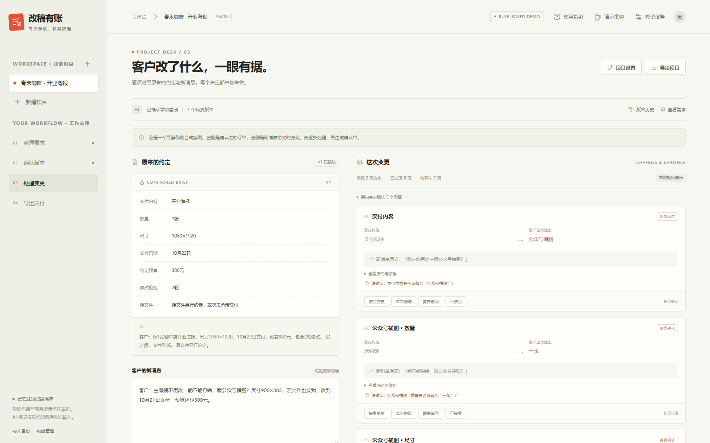

# 改稿有账

独立设计师的需求变更助手。版本 **1.2.0**。参赛者：**徐东**，OPC 个人创新赛道，个人参赛。

把客户聊天整理为经人工确认的需求版本；新消息与该版本比较，显示变化和原话；设计师决定接受、赠送、追问或不接受，程序保存新版本、按人工设置算价并导出确认单。



## 立即体验

在 GitHub 仓库首页点击 **Code → Download ZIP**，下载后完整解压。

完整解压后，**双击 `双击体验.html`**，即可使用不联网、不需要密钥的本地规则版。默认载入合成的咖啡店海报案例，可修改文本重新分析。

1. 核对右侧候选变化和原文，逐项选择接受、赠送、追问或不接受。
2. 问句要填写已确认的具体值。每项新增交付独立处理收费或赠送：横图可用价目表单价，其他物料须手填金额或明确赠送，未定价收费项不能保存。
3. 检查费用后点击“保存决定，生成确认单”，导出 Markdown、JSON，或打印为 PDF。
4. 查看版本历史；新建项目可以从头处理自己的脱敏订单。

详细步骤见根目录 `新手指南.md`，与 `docs/新手使用指南.md` 内容相同。浏览器会在本机保存项目，请定期导出 JSON 备份。

## 接入真实 AI

1. 安装 Node.js 20 或更高版本，无需安装 npm 依赖。
2. 双击 `启动作品.cmd`，保持启动窗口开启，访问 `http://127.0.0.1:4173`。
3. 右上“模型设置”选择“AI 模式”，填写供应商、模型和自己的 API Key。
4. 点击“测试连接”，成功后“保存本次设置”，再分析合成样本并人工核对。

支持 DeepSeek、通义千问的固定兼容接口。作品默认 DeepSeek 模型名 `deepseek-flash`，千问默认 `qwen-plus`，均可按账户可用模型修改。千问使用北京地域入口，可选填北京子业务空间 ID。

保存设置不会自动测试密钥。连接测试使用固定短合成样本，会产生实际 API 调用费用；模型需返回有效样本回复并通过检查才显示成功。输入、项目或模型配置发生变化后，旧响应不会替代新输入的分析。

密钥仅留在当前页面内存中，不写入项目、本地存储或导出文件，刷新后清空。AI 分析会把本次聊天及必要需求发送给所选服务商，请先脱敏并取得使用许可。开发检查中的模型请求采用模拟响应；尚未由制作方使用真实密钥验证服务连通与识别效果，不宣称模型准确率或提效比例。

官方资料：[DeepSeek JSON 输出](https://api-docs.deepseek.com/guides/json_mode/)；[千问兼容接口](https://help.aliyun.com/zh/model-studio/compatibility-of-openai-with-dashscope)。

也可在项目目录运行：

```text
node server.mjs
```

## 功能与边界

- 提取交付物、数量、尺寸、日期、修改次数、预算及源文件约定，关联原文。
- 新增交付的规格保留具体对象，不覆盖主海报尺寸；复杂多物料指代仍需人工核对。
- 接受或赠送后形成新版本，追问或拒绝不改变已确认范围，旧版本保留。
- 每项费用独立计算。横图可用自设费率，其他新增交付人工填写本次金额；未定价不能保存。赠送为 0，加急需手动勾选。原预算独立保留。
- 支持项目管理、JSON 导入与导出、Markdown 确认单、沟通草稿和打印。
- 规则和模型都会出现漏判与误判。引用校验只检查可复核依据，不能证明业务判断正确。询问、相对日期和不明确对象需要确认。

## 参赛材料

- `docs/`：报名摘要、项目说明、答辩问答、三分钟脚本、AI 使用说明、开发检查与待执行评测计划。
- `docs/评测方案与记录.csv`：仅表头，零数据行；没有真实用户成绩或未经验证的用时。
- `徐东_改稿有账_参赛汇报_v1.2_终稿.pptx`：可编辑汇报文件。
- `操作演示_规则模式_无配音.mp4`：约 39 秒的早期规则版实机短片；最终功能以 1.2.0 页面为准。
- `提交前请先看.md`：提交材料检查与现场 AI 验证步骤。

示例均为合成，真实用户、商业收益和真实模型效果尚待验证。作品包不代表已报名或提交；最终字段、资格和提交方式以主办方公告及实际报名页为准。若入口要求代码仓库或评委可访问的 Demo 地址，需提供有效链接，ZIP 附件不能自动代替链接。

## 源码与检查

```text
core/engine.mjs   规则提取、变更关联、版本更新和确定性算价
core/ai.mjs       模型请求、结构与原文引用校验、连接测试
dist/            网页界面及静态发布文件
server.mjs       仅监听本机的 HTTP 服务及模型代理
tests/           核心与接口自动检查
docs/            参赛说明与评测材料
```

运行核心检查：

```text
node --test tests/*.test.mjs
```

本版检查：50 项核心与接口检查、68 项浏览器检查、10 项离线检查均通过；合计 128 项。模型接口使用模拟响应，未实测真实模型。详见 `docs/开发检查记录.md`。代码采用 MIT 许可证，第三方服务条款独立适用。
